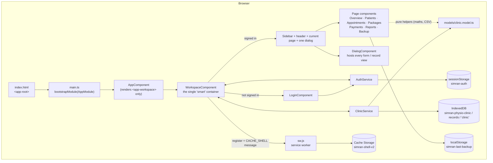
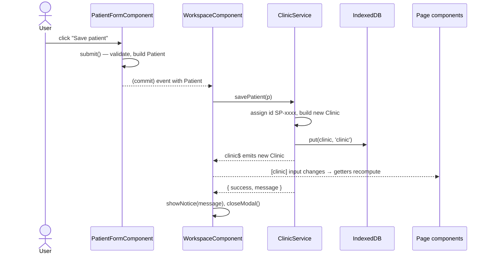
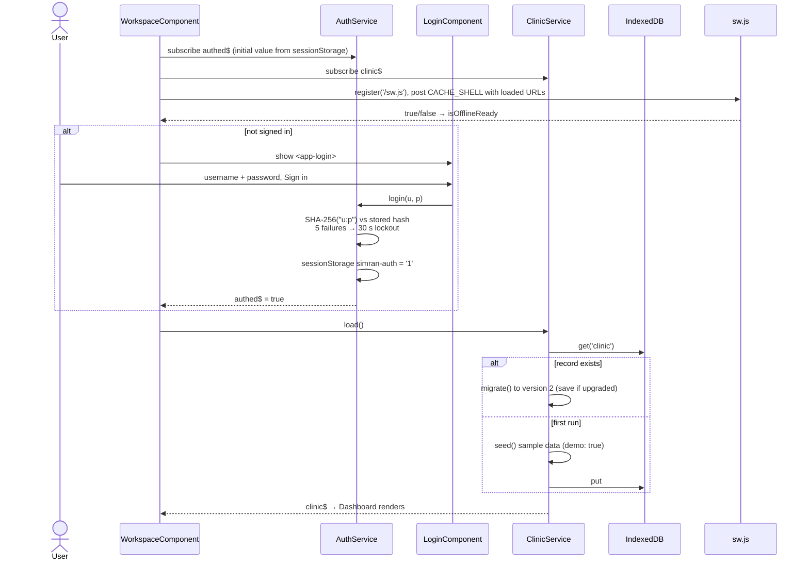
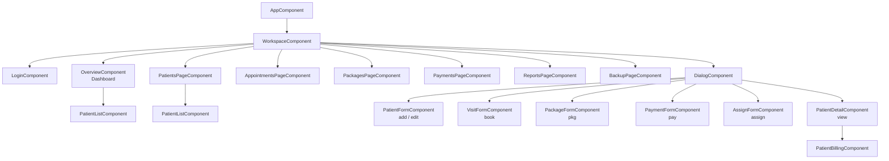
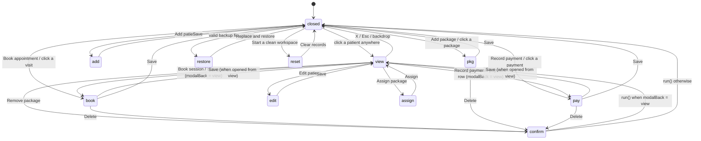
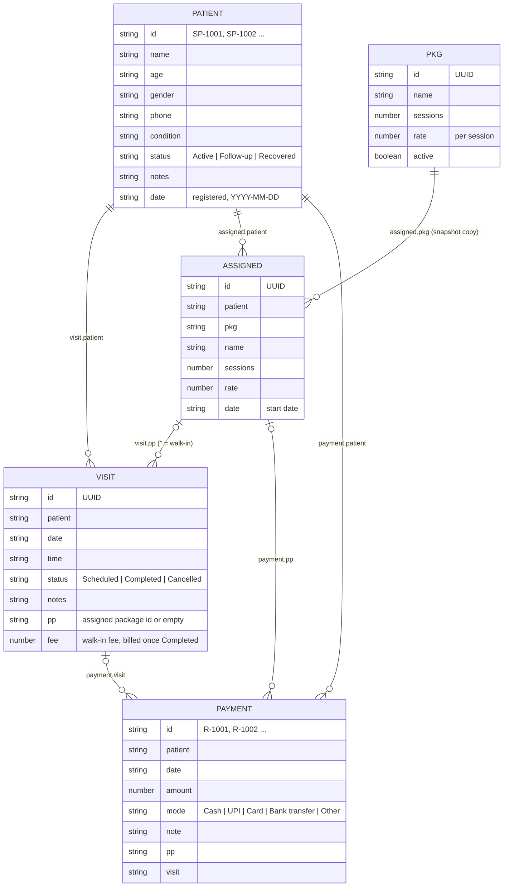

# Architecture — Simran Physiotherapy Clinic Workspace

An offline-first Angular 16 app for a single physiotherapy clinic: patients, appointments, session packages, payments, CSV reports and backups. There is **no backend** — every record lives in the browser's IndexedDB on the device that uses it.

> For a page-by-page list of buttons and the functions they call, see [PAGES.md](PAGES.md).

---

## 1. The big picture



### Layers

| Layer | Files | Responsibility |
|---|---|---|
| Bootstrap | [main.ts](../src/main.ts), [app.module.ts](../src/app/app.module.ts), [app.component.*](../src/app/app.component.ts) | Starts Angular, declares all 21 components, renders `<app-workspace>` |
| Container | [workspace.component.ts](../src/app/components/workspace/workspace.component.ts) | Holds all UI state (current page, open dialog, selected records), handles every event, calls services |
| Pages | `components/overview`, `patients`, `appointments`, `packages`, `billing`, `system-pages` | Display data received via `@Input() clinic`, emit `@Output()` events on clicks |
| Forms / dialogs | `components/dialog`, `dialog-forms`, `billing`, `packages` | Local form state; emit a finished object on submit |
| Shared UI | `components/icon`, `badge` | Inline SVG icons, coloured status pill |
| Services | [auth.service.ts](../src/app/services/auth.service.ts), [clinic.service.ts](../src/app/services/clinic.service.ts) | Sign-in state; IndexedDB load/save and all record mutations |
| Model | [clinic.model.ts](../src/app/models/clinic.model.ts) | Types, formatting, billing maths, seed data, backup validation/migration, CSV export |
| Offline | [sw.js](../src/sw.js) | Caches the app shell so it opens without internet |

---

## 2. Key design decisions

1. **No Angular Router.** `AppRoutingModule` has an empty route list. Navigation is just `WorkspaceComponent.currentPage = 'Patients'` etc., and the template shows the matching page with `*ngIf`. Consequence: no per-page URL, browser Back doesn't change pages, and a refresh returns to Dashboard.

2. **One smart component, many dumb ones.** Only `WorkspaceComponent` injects `ClinicService`. Child components never mutate data — they emit an event, the workspace calls the service, the service saves and broadcasts the new data, and it flows back down as `@Input`.

3. **One dialog, switched by a string.** There is a single `<app-dialog>`; `modalMode` (`'add' | 'edit' | 'view' | 'book' | 'pkg' | 'pay' | 'assign' | 'confirm' | 'reset' | 'restore'`) decides which form is inside it. `modalBack = 'view'` means "return to the patient record after saving".

4. **Whole-document storage.** The entire clinic (`Clinic` object) is stored as one value under key `'clinic'`. Every change builds a new immutable `Clinic` and writes the whole thing.

5. **Derived numbers are never stored.** Sessions used/left, amount billed, received and balance are always recalculated from visits and payments (`used`, `left`, `billed`, `received`, `balance` in the model). Editing or deleting a visit can therefore never double-count.

6. **Package sales are snapshots.** When a package is assigned to a patient, its name, session count and rate are copied into an `Assigned` record. Editing the package master later only affects future sales.

---

## 3. Data flow (one-way loop)

Every write in the app follows the same loop. Example: saving a new patient.



All other writes (`saveVisit`, `completeVisit`, `savePayment`, `assignPackage`, deletes, restore, reset) use the same pattern.

---

## 4. Startup and sign-in



- Sign-in lasts for the browser tab session (`sessionStorage`). Closing the tab signs out.
- `login()` needs `crypto.subtle`, so the app must be served over **https** (or `localhost`).
- `LoginComponent` also emits `loginSuccess`, which calls `loadClinicData()` a second time alongside the `authed$` subscription. Harmless (same data) but redundant.

---

## 5. Component tree



`IconComponent` and `BadgeComponent` are used throughout and omitted above.

---

## 6. Dialog state machine (`modalMode`)



Any dialog closes on the X button, the Escape key or a backdrop click (`DialogComponent` → `closeModal()`).

---

## 7. Data model

All types are in [clinic.model.ts](../src/app/models/clinic.model.ts). The stored document:

```ts
type Clinic = { version: 2; demo: boolean;
  patients: Patient[]; visits: Visit[]; packages: Pkg[];
  assigned: Assigned[]; payments: Payment[] };
```



### Billing maths (derived, never stored)

| Function | Formula |
|---|---|
| `used(d, ppId)` | Completed visits linked to that assigned package |
| `left(d, a)` | `max(0, a.sessions − used)` |
| `remainingFor(d, patient)` | Sum of `left` over the patient's packages |
| `billed(d, patient)` | Σ package `sessions × rate` + Σ `fee` of Completed walk-in visits |
| `received(d, patient)` | Σ payment amounts |
| `balance(d, patient)` | `billed − received` — positive = due, negative = advance |
| `attention(d)` | Patients with ≤ 1 session left (and not Recovered) or a balance due — feeds the Dashboard's "Needs attention" |

---

## 8. Storage and offline

| Store | Key | Written by | Contents |
|---|---|---|---|
| IndexedDB `simran-physio-clinic` → store `records` | `clinic` | `ClinicService.save()` | Entire `Clinic` object |
| sessionStorage | `simran-auth` | `AuthService.login()/logout()` | `'1'` when signed in |
| localStorage | `simran-last-backup` | `BackupPageComponent.onDownloadBackup()` | Date of last backup download |
| Cache Storage | `simran-shell-v2` | `sw.js` | App shell (HTML, JS, CSS, images) |

**Service worker** ([sw.js](../src/sw.js), copied to the build by the `assets` list in `angular.json`):
- `install` — pre-caches `/`, `/index.html`, the hero image and logo.
- `message CACHE_SHELL` — the workspace sends every URL the page loaded; the worker caches same-origin ones and replies `true`, which turns on "cached for offline use" on the Backup page.
- `fetch` — network first, cache fallback. Page navigations are cached under `/`.

**Backup / restore** — Backup downloads `Simran-backup-YYYY-MM-DD.json` (the raw `Clinic` object). Restore runs `valid()` (shape, ID uniqueness, referential checks), then `migrate()` (v1 → v2), shows a count summary and replaces everything on confirm.

**CSV reports** — `report()` builds one of six reports, guards against spreadsheet formula injection, adds a UTF-8 BOM for Excel and downloads `Simran-<report>-YYYY-MM-DD.csv`.

---

## 9. Things to know before changing the code

- **Security is device-level, not server-level.** The username/password hash is in the JavaScript bundle and the check runs in the browser; it keeps casual users out but cannot stop someone with the files. Patient data in IndexedDB is not encrypted — rely on a locked, encrypted device and keep backups private.
- **Clearing browser site data deletes all records.** Encourage regular backups.
- **Data is per browser, per device.** Two computers do not share records; move data with backup/restore.
- **Adding a page:** add an entry to `navItems` (and `topActionMap` if it needs a header button), a `*ngIf="currentPage === '…'"` block in the workspace template, and declare the component in `AppModule`.
- **Adding a dialog:** add a `modalMode` value, a block inside `<app-dialog>`, a title in the `modalTitle` getter and, if wide, in `isWideModal`.
- **Adding a field to a record:** update the type, `seed()`, `valid()` and `migrate()` in the model so old backups still restore.
